# Skills for Real Scientists

[](https://github.com/HiteSit/real-scientist-skills/releases/latest)
[](https://agentskills.io)
[](https://github.com/HiteSit/real-scientist-skills/actions/workflows/sync-upstream.yml)
[](./LICENSE)

Built on [Matt Pocock's skills for real engineers](https://github.com/mattpocock/skills).

Agent skills for reproducible scientific experiments with any coding agent. Agree on one experiment at a time, record the expected result before running it, and use the evidence to choose what to run next. Every run leaves a Git-tracked lab notebook and rerunnable files.

<p align="center">
  
</p>

<details>
<summary>Watch it as a video, with pause and seek</summary>

https://github.com/user-attachments/assets/155b6bd3-aa72-4782-982f-cd4c7ec5e4ea

</details>

## Why one experiment at a time

Matt's engineering flow plans the whole route first: `/to-spec` writes down the goal, `/to-tickets` splits it into tickets, and `/implement-spec` builds them, many in parallel. That works because software is predictable once you agree on what to build.

Research and scientific exploration aren't. You learn what's relevant by running something and looking at the result. So the science flow agrees one experiment, called a probe, at a time. Each observation goes in the notebook while it is fresh. You can compare several probes later before deciding which direction to take.

Ask a language model a question without steering it, and it gives you the most common answer, the middle of everything it has read. New findings sit away from that middle, and only a clear intention moves the work away from it, away from what you could call AI slop. So before each run the agent writes down the standard answer, and the result shows how far from it reality lands. That distance is what makes the work worth doing, and a rough measure of how unique it is.

|                    | Engineering flow                    | Science flow                                         |
| ------------------ | ----------------------------------- | ---------------------------------------------------- |
| The unknown        | How to build it                     | What's relevant, and so what to do next              |
| Plan               | Every ticket, up front              | The first probe and a list of ideas; each next probe chosen when it's next |
| Shape of the work  | A task graph, run in parallel       | Agreed probes; findings can be interpreted together |
| Where work happens | Feature branches, into the codebase | Scratch probes in a study folder; the main tree changes only by promotion |
| The starting doc   | A spec, which is a contract         | A direction, which is expected to change             |
| Failure            | A bug to fix                        | Unexpected results teach; invalid runs need fixing   |

When a protocol stops changing, it's predictable again, and Matt's engineering flow takes over.

## What lives where

Scientific records live under `.science/`; approved reusable work and the root scientific map follow your existing project layout:

```
.science/
  SETUP.md              your setup
  library/              what you read: papers, software docs; one page per question, the raw search results
  data/                 user inputs and approved shared datasets (or root data/)
  <study>/              one folder per study
    STUDY.md            the starting direction and first probe, frozen; promotions and the outcome are added at the end
    NOTEBOOK.md         the map: threads of the question, each probe's asked / expected / found / means, a log of every operation
    dashboard.html      the study's dashboard
    _promotion_<title>_<date>/ README, digest manifest; physical numbered folders under:
      promoted/ retained/ discarded/ active/   plus relative links to current asset homes
    probes/             current new-question batch; empty immediately after rollover
```

`/promote` separates technical reuse from physical batch rollover. After exact-tree approval, numbered folders move directly into a cycle's `promoted/`, `retained/`, `discarded/` or `active/`, alongside relative links where appropriate. Each payload has one physical home. No extra record layer, copies or old-path aliases refill `probes/`; that empty batch accepts new globally numbered questions and later rolls into another cycle. Unfinished probes continue under the same ID at their cycle `active/` location. `NOTEBOOK.md` hrefs locate current records across cycles; physical disposition and partial technical promotion change neither scientific verdict nor unfinished status. Existing-cycle moves require explicit approval and checkpoint tags preserve history. Keep code in actual useful homes without compulsory porting/refactoring.

Shared data can include approved general source/prepared/reference datasets with provenance and checksums, not just user inputs. Ordinary fetched data stays probe-local until approved promotion; workflow databases and run outputs stay with their workflow.

Alternative approaches to the same question stay in notebook **Ideas**, visibly unexecuted. Once chosen, each becomes an ordinary next globally numbered probe. **Builds on** links express its dependencies; the next promotion cycle organizes its findings. No separate approach folders or lifecycle are needed. A different question still belongs in another study after off-axis triage.

Run `/scientific-map` at any stage, even before the first promotion. It builds one project-root `scientific-map.html` with a tab for each in-scope study. Each tab shows the question, probes, findings, ideas and promotion cycles with typed links and source details. `/promote` refreshes the shared map and selects the study it just promoted. Build with your existing tools; open the HTML offline in a browser. Study dashboards still hold the charts.

The notebook, maps and dashboards use a concise operational voice by default. `STUDY.md` keeps a natural, direct narrative and its frozen starting record. [Presentation voices](./skills/science/lab-notebook/SKILL.md#presentation-voices) defines the style target, preservation rules and project overrides.

Studies share the current checkout by default. Checkpoints use exact approved paths and preserve unrelated work; hooks, commits, publishing, branch/worktree operations and optional safe cleanup respect explicit authorization. Cycle tags are `<study>/promotions/<title>-<date>`, never overwritten.

## The skills

You type `/maintain-science`, `/experiment`, `/curate-probe`, `/promote` and `/scientific-map`. The agent loads `lab-notebook` and `desk-research` on its own when the task fits.

- [maintain-science](./skills/science/maintain-science/SKILL.md): set up or refresh a repo, migrate older record formats with approval, or review a study as it stands. Ask for just the parts you want.
- [experiment](./skills/science/experiment/SKILL.md): open or resume a study. Run, organize, verify and checkpoint probe work; compare results or record your decision when you're ready.
- [curate-probe](./skills/science/curate-probe/SKILL.md): tell it what you want to find, compare or use. It arranges one probe for that purpose, repairs live references and keeps a recovery record.
- [promote](./skills/science/promote/SKILL.md): organize, technically promote and preserve work in repeated approved-tree cycles, with current-consumer checks and a scientific map.
- [scientific-map](./skills/science/scientific-map/SKILL.md): build or refresh one offline HTML map of the project, with an experiment tab for each study. Run it on demand or through promotion.
- [lab-notebook](./skills/science/lab-notebook/SKILL.md): the study's layout and formats: notebook, probe folders, result briefs, plots and dashboard.
- [desk-research](./skills/science/desk-research/SKILL.md): answer questions by reading papers and documentation in parallel, into a shared library, with citations.

The flow step by step, the principles behind it and the vocabulary: [skills/science/README.md](./skills/science/README.md).

Matt's engineering and productivity skills are included as he wrote them, and the science skills call several of them (`grilling`, `domain-modeling`, `tdd`, `code-review`, `pr`). For what each one does, see [his README](https://github.com/mattpocock/skills).

## Install

Paste this prompt into your coding agent. It installs the science skills, and Matt's skills if missing. The scientific map needs no separate renderer installation:

```text
Install the science skills from https://github.com/HiteSit/real-scientist-skills.

1. Clone the repo, or pull it if I already have a clone.
2. Find the folder you load skills from.
3. Check that folder for Matt Pocock's skills, such as grilling, tdd and domain-modeling.
   - If they're there, keep them and install only the skills in skills/science/.
   - If they're missing, install the skills in skills/science/ plus every skill in skills/engineering/ and skills/productivity/. When a skill has a folder in customized/, use that folder instead.
4. Install each skill as a symlink into the clone, so a git pull updates it. If a skill with the same name is already in the folder, ask me before replacing it.
5. Keep scientific-map build and viewing dependency-free: native browser code and my project's existing standard-library runtime. Do not install or vendor an external renderer unless I explicitly choose that exception.
6. Tell me what you installed and skipped. Then remind me to run /maintain-science to configure my repo, and /setup-matt-pocock-skills if you installed Matt's skills.
```

To update, ask your agent to pull the clone.

## Staying in step with Matt

Every week this repo merges Matt's latest skills, and it keeps a few small edits to two of them. [MAINTAINING.md](./MAINTAINING.md) explains how.

## Credits and license

The engineering and productivity skills, the repo's structure, and the ideas the science bucket grows from are the work of [Matt Pocock](https://www.aihero.dev). If you like these skills, read [his README](https://github.com/mattpocock/skills#why-these-skills-exist) and join [his newsletter](https://www.aihero.dev/s/skills-newsletter).

- Everything under `skills/` except `skills/science/` is Matt's, from [mattpocock/skills](https://github.com/mattpocock/skills), merged in unchanged every week.
- `customized/` holds edited copies of two of his skills, `grilling` and `chief-of-staff`, rebuilt from his originals plus the edits in `customizations/`.
- `skills/science/` and the docs around it are new here.

Matt's skills are MIT licensed, and so is this repo. His [LICENSE](./LICENSE) is kept as he wrote it.
